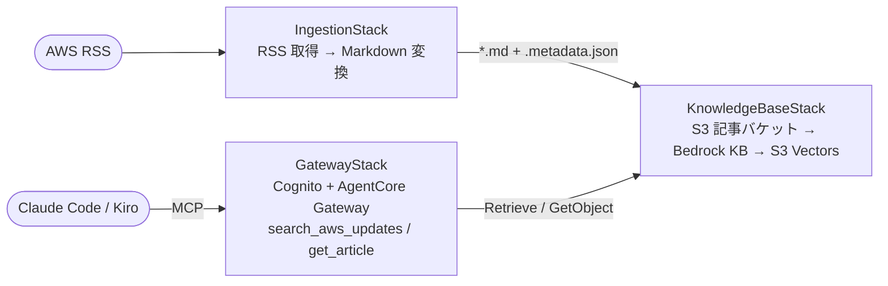

# awsnews-kb-mcp

AWS What's New / AWS 公式ブログの RSS を定期取得して Amazon Bedrock Knowledge Base に
取り込み、Claude Desktop / Kiro / Claude Code から MCP 経由で検索・深掘りできるようにする
ハンズオン教材。

> このハンズオンは実際に AWS リソースを作成し、課金が発生します。手順の最後にある
> 削除手順を必ず実行してください。

詳細な設計・ディレクトリ構成・技術選定の理由は [CLAUDE.md](CLAUDE.md) と
[docs/adr/](docs/adr/) を参照してください。

## 構成



| ディレクトリ | 内容 |
|---|---|
| `packages/infra` | CDK（3スタック） |
| `packages/ingestion` | 取り込み側の Lambda（Fetch / Ingest Trigger / Notifier） |
| `packages/tools` | MCP ツールの Lambda |
| `client` | MCP クライアントの接続手順 |
| `scripts` | 取り込み状況の確認、メタデータの追記 |

リソース構成、コードとスタックの対応、処理の流れ、メタデータ項目、既知の課題は
[docs/design.md](docs/design.md) にまとめています。

## ステータス

このハンズオンは以下のフェーズで段階的に構築します。現在の進捗:

- [x] Phase 0: プロジェクト初期化
- [x] Phase 1: KnowledgeBaseStack（S3 記事バケット、S3 Vectors、Bedrock KB）— `ap-northeast-1` にデプロイ済み
- [x] Phase 2: IngestionStack（RSS 取得 → Markdown 変換 → KB 取り込み）— 130記事の初回同期・KB検索まで確認済み
- [x] Phase 3: GatewayStack（Cognito、AgentCore Gateway、MCP ツール）— `ap-northeast-1` にデプロイ済み。
      `mcp-remote` からの実接続はまだ未検証
      （[docs/adr/0004](docs/adr/0004-gateway-cognito-app-client.md)、[client/README.md](client/README.md) 参照）
- [ ] Phase 4: 動作確認・コスト実測・削除手順の確定

## 前提条件

- AWS アカウント（Bedrock のモデルアクセスを有効化できる権限）
- AWS CLI v2（Bedrock / S3 Vectors / AgentCore コマンドに対応した比較的新しいバージョン）
- Node.js（Volta でバージョン固定。`packages/infra/package.json` 参照）
- Python 3.13 系、[uv](https://docs.astral.sh/uv/)
- （任意）Slack Incoming Webhook URL（アラーム通知を Slack にも飛ばしたい場合）

## コスト見積もり

（Phase 4 で実測値に更新します。現時点は概算）

- S3 Vectors: ストレージ + クエリ課金のみ。放置時はほぼ0
- Bedrock Knowledge Base: Ingestion 時の埋め込み呼び出し課金のみ。放置時は0
- DynamoDB / SQS / Lambda / EventBridge Scheduler: オンデマンド課金、ハンズオン規模ならごく小額
- Cognito User Pool: MAU 課金だが少人数のハンズオンなら無料枠内
- AgentCore Gateway: 呼び出し課金。放置時はごく小額
- **常時課金の固定コスト（NAT Gateway 等）は意図的に含めていない**

## デプロイ

（Phase 1 以降、各スタックのデプロイ手順をここに追記します）

```bash
cd packages/infra
npm install
npx cdk bootstrap   # 初回のみ
npx cdk deploy KnowledgeBaseStack
npx cdk deploy IngestionStack
npx cdk deploy GatewayStack
```

## 接続（Kiro / Claude Code）

`GatewayStack` デプロイ後の接続手順は [client/README.md](client/README.md) と
[client/mcp.json.example](client/mcp.json.example) を参照してください。
実機での接続確認はまだ行っておらず、未検証事項は client/README.md に明記しています。

## 動作確認の質問例

（実機接続確認後に、`search_aws_updates` / `get_article` を使った質問例を追記します）

## S3 → KB → S3 Vectors の取り込み状況を確認する

```bash
# Ingestion Job履歴 + ドキュメントのステータス別件数（INDEXED件数など）
scripts/check-kb-sync.sh

# 特定記事がS3 Vectorsまで登録済みか追跡する（S3キー/URLの一部を指定）
scripts/check-kb-sync.sh aurora-dsql
```

## トラブルシュート

（Phase 2〜4 で判明した詰まりどころは [docs/lessons/](docs/lessons/) にも記録します）

## 削除手順（課金ゼロに戻す）

```bash
cd packages/infra
npx cdk destroy --all
```

削除後、以下を AWS コンソールで確認してください（CDK 管理外リソースが残っていないか）:

- S3 バケット（`RemovalPolicy` によっては手動削除が必要な場合あり）
- CloudWatch Logs ロググループ
- Secrets Manager / SSM パラメータ

## ライセンス・注意事項

社内ハンズオン教材です。RSS 取得先（AWS 公式サイト）の利用規約の範囲内で利用してください。
