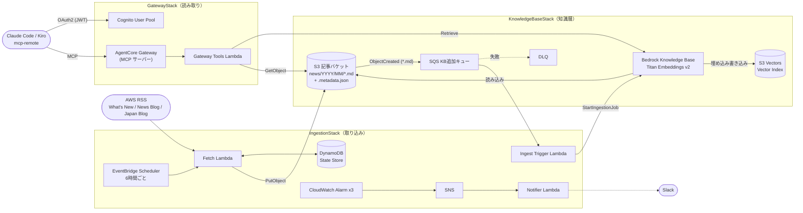
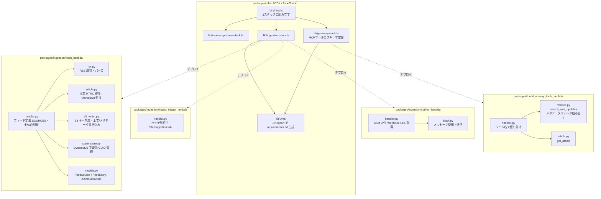
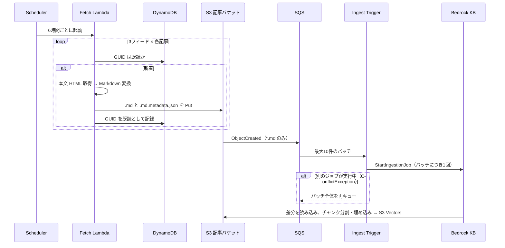
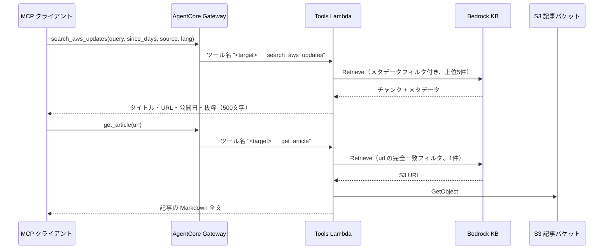

# 設計書

awsnews-kb-mcp の現状の構成（2026-10-18 時点のコード）をまとめた設計書。
設計判断の理由は [docs/adr/](adr/)、実装中のハマりどころは [docs/lessons/](lessons/) を参照。

## 1. システム構成

CDK のスタック単位で示す。取り込み側（書き込み専任）と読み取り側（読み取り専任）は
直接つながらず、S3 記事バケットと Bedrock KB だけを接点にする。

| スタック | 主なリソース | 依存先 |
|---|---|---|
| `KnowledgeBaseStack` | S3 記事バケット、S3 Vectors（Vector Bucket / Index）、Bedrock KB とデータソース、SQS KB追加キューと DLQ、S3 イベント通知 | なし |
| `IngestionStack` | Fetch / Ingest Trigger / Notifier の各 Lambda、DynamoDB、EventBridge Scheduler、CloudWatch Alarm、SNS | `KnowledgeBaseStack`（バケット、キュー、KB ID などを props で受け取る） |
| `GatewayStack` | Cognito User Pool、AgentCore Gateway と Target、Gateway Tools Lambda | `KnowledgeBaseStack`（バケット、KB ID） |

SQS キューを `IngestionStack` ではなく `KnowledgeBaseStack` に置いている理由は
[ADR-0003](adr/0003-ingestion-queue-in-knowledge-base-stack.md) を参照（S3 イベント通知の
カスタムリソースがバケット側のスタックに作られ、循環依存になるため）。

## 2. コード構成

どのソースコードが、どのスタックの Lambda としてデプロイされるかを示す。

| パス | 役割 |
|---|---|
| [packages/infra/](../packages/infra/) | CDK v2。Python Lambda は `PythonFunction` と `uv export` でビルドする（[ADR-0002](adr/0002-lambda-dependency-management.md)） |
| [packages/ingestion/](../packages/ingestion/) | 取り込み側の Lambda 3つ。uv workspace のメンバー |
| [packages/tools/](../packages/tools/) | 読み取り側の Lambda（MCP ツールの実体） |
| [client/](../client/) | MCP クライアントの設定例と接続手順 |
| [scripts/check-kb-sync.sh](../scripts/check-kb-sync.sh) | Ingestion Job 履歴とドキュメントのステータスを確認する |
| [scripts/backfill-metadata.sh](../scripts/backfill-metadata.sh) | 取り込み済み記事のメタデータに項目を追記し、KB を再同期する |

各 Lambda は boto3 クライアントをモジュールスコープで生成し、テストでは `monkeypatch` で
差し替える。外部 API を呼ぶ関数は `Protocol` で依存を表し、偽物のクライアントでテストする。

## 3. 処理の流れ

### 3.1 取り込み

- `StartIngestionJob` はデータソース全体を同期する API のため、レコードごとではなく
  バッチごとに1回だけ呼ぶ（[lessons 0002](lessons/0002-ingest-trigger-must-call-once-per-batch.md)）
- `.metadata.json` だけを更新しても S3 イベントは発生しないため、取り込みは自動では起動しない

### 3.2 検索（MCP ツール）

回答文はクライアント側の LLM が作る。サーバー側では回答を生成しない。

## 4. データ設計

### 4.1 S3 オブジェクト

- 本文: `news/YYYY/MM/<タイトルのslug>-<GUIDのSHA1先頭8桁>.md`
- メタデータ: 本文と同じキーに `.metadata.json` を付けたもの。Bedrock KB が自動で関連付ける

### 4.2 メタデータ項目

| キー | 型 | 例 | 用途 |
|---|---|---|---|
| `title` | 文字列 | `Amazon CloudWatch log centralization now available ...` | 結果の表示 |
| `url` | 文字列 | `https://aws.amazon.com/about-aws/whats-new/2026/10/...` | 結果の表示、`get_article` の完全一致検索 |
| `published_at` | 文字列（ISO8601、UTC） | `2026-10-16T20:04:00+00:00` | 結果の表示 |
| `published_at_epoch` | 数値（Unix 秒） | `1792181040` | `since_days` の範囲フィルタ |
| `source` | 文字列 | `whats-new` / `news-blog` / `jp-blog` | 出典での絞り込み |
| `lang` | 文字列 | `en` / `ja` | 言語での絞り込み |
| `category` | 文字列 | （現状 `source` と同じ値） | 予約。意味のある分類に作り直す予定 |

- S3 Vectors の範囲比較（`greaterThan` など）は数値にしか使えず、`startsWith` は未対応。
  そのため日付は `published_at_epoch` で比較する（[lessons 0005](lessons/0005-s3-vectors-filter-operators.md)）
- フィルタに使えるメタデータは1ベクトルあたり合計 2048 バイトまで。Bedrock の内部キー
  `AMAZON_BEDROCK_TEXT` / `AMAZON_BEDROCK_METADATA` はフィルタ対象外にしている
  （[lessons 0003](lessons/0003-s3-vectors-filterable-metadata-limit.md)）

### 4.3 チャンキング

固定サイズ（500 トークン、重なり 20%）。What's New はほぼ1チャンクに収まり、長いブログは
数十チャンクに分かれる。チャンキングの設定はデータソース作成後に変更できない。

## 5. MCP ツール

| ツール | 引数 | 返り値 |
|---|---|---|
| `search_aws_updates` | `query`（必須）、`since_days`、`source`、`lang`、`category` | 上位5件のスコア・タイトル・URL・公開日・出典・言語・抜粋 |
| `get_article` | `url`（必須） | 記事のタイトル・公開日・Markdown 全文 |

ツールのスキーマは [gateway-stack.ts](../packages/infra/lib/gateway-stack.ts) の
`inlinePayload` に定義し、処理の実体は [packages/tools/](../packages/tools/) にある。

## 6. 監視

| アラーム | 発火条件 | 通知先 |
|---|---|---|
| `KbIngestDlqNotEmptyAlarm` | DLQ にメッセージが残っている | SNS → Notifier Lambda → Slack（任意）、メール（任意） |
| `FetchFailureAlarm` | Fetch Lambda のエラー | 同上 |
| `IngestFailureAlarm` | Ingest Trigger Lambda のエラー | 同上 |

## 7. 既知の課題（2026-10-18 時点）

| 課題 | 状態 |
|---|---|
| `published_at_epoch` / `lang` の追加 | コードは修正済み。`IngestionStack` のデプロイと既存650件への追記（`backfill-metadata.sh --apply`）は未実施 |
| Slack 通知が失敗する | SSM パラメータ名 `/awsnews-kb-mcp/...` が予約名（`aws` で始まる）に当たる。SSM は先頭の `/` を除いて判定するため、`aws` で始まらない名前への変更が必要 |
| DLQ アラームが 2026-09-05 から ALARM のまま | Phase 2 の検証時に溜まったメッセージと思われる。未調査 |
| Ingestion Job が多い（約6週間で419回） | SQS バッチごとにジョブが起動するため。料金への影響は小さい |
| 同じ記事のチャンクが検索結果を占める | `search_aws_updates` で URL ごとにまとめる処理が未実装 |
| MCP クライアントからの接続 | 未検証。Tools Lambda の呼び出しは0回 |
| `category` が `source` と同じ値 | 意味のある分類（サービス名、分野など）に作り直す予定 |
